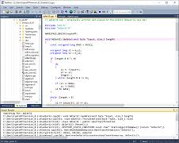
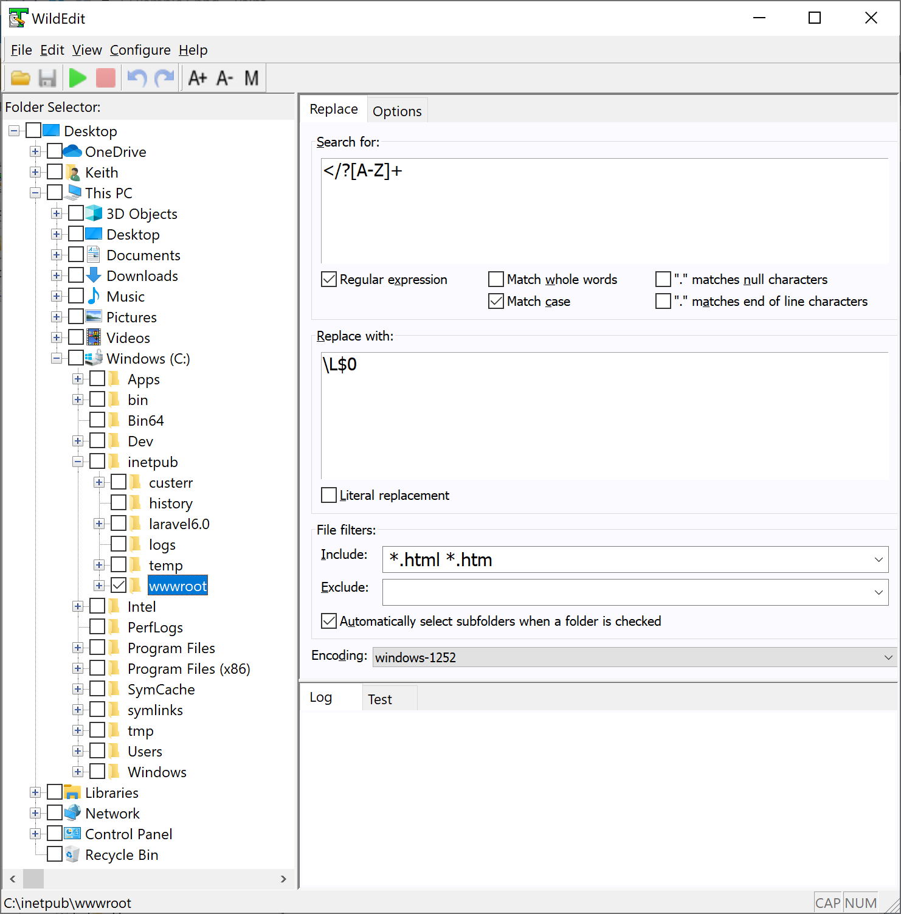
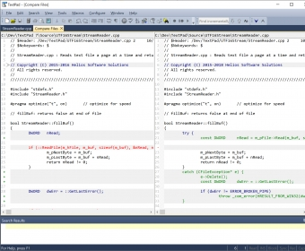

# TextPad for Plain Text and Code Work

TextPad Helios combines multi-document editing, regular-expression search, recorded keystrokes, and external tools in a Windows desktop editor developed by Helios Software Solutions.

## Find the change before replacing it

Start a cross-file edit with a search that makes the intended matches visible.
TextPad can search directory trees and replace text across open documents, so the search location and replacement scope deserve separate attention.

A practical review sequence is:

1. Limit Find in Files to the relevant folder and filename patterns.
2. Open several representative matches, including an awkward edge case.
3. Test the expression in one document or selection.
4. Compare the edited result before expanding to other open documents.

The following independent Perl-style patterns cover a TODO annotation, leading indentation, and trailing horizontal whitespace, respectively.
Use one pattern at a time with regular-expression search enabled:

```regex
TODO:[ \t]*[^\r\n]*
^[ \t]+
[ \t]+$
```

The whitespace patterns also match indentation or trailing spaces that may be meaningful to another tool.
Use the supplied CudaText [mass replace, also multiline.txt](testfiles/test_features/mass%20replace,%20also%20multiline.txt) fixture to inspect matches spanning several physical lines.
The [text with indentation.txt](testfiles/test_features/text%20with%20indentation.txt) sample makes uneven indentation visible during selection and replacement experiments.

[](https://textpad-helios.github.io/TextPad-Editor/)

## Give document classes consistent defaults

TextPad Editor document classes associate filename extensions with preferences such as fonts, tab stops, syntax colors, and character encoding.
Two files can look similar while using different byte encodings, tab widths, or line endings.

### Separate appearance from stored text

Enable visible tabs and spaces when alignment matters.
Use column selection for a rectangular edit, and inspect the surrounding lines before applying the same change to every row.
A tab occupies display space according to tab stops; it is not a fixed number of stored spaces.

Unicode examples provide useful comparison material:

- [emoji.txt](testfiles/emoji.txt) contains individual emoji among ordinary text.
- [emoji combined.txt](testfiles/emoji%20combined.txt) contains joined emoji sequences and descriptive labels.
- [wide_chars.txt](testfiles/wide_chars.txt) contains less common Latin characters for font inspection.
- [encoding-detection-by-first-line](testfiles/encoding-detection-by-first-line) contains alternative encoding declarations used by the CudaText fixture.

Treat an encoding declaration in document text separately from the encoding selected when opening or saving.
The fixture's reopening instructions describe CudaText behavior; they do not define TextPad's encoding detection.



### Keep distant passages in view

TextPad supports up to two views per file and workspaces that restore an editing session.
Use the second view to keep a definition or reference passage visible while changing another part of the same document.
Check whether a split view refers to the same file before treating it as a before-and-after comparison.

## Read mixed syntax as plain text

The textpad text editor can apply document-class syntax colors, while the saved file remains text.
For a web template, distinguish markup, template delimiters, embedded styles, and script text before choosing the boundaries of an edit.

These CudaText samples make those boundaries concrete:

- [django.html](testfiles/test_features/django.html) mixes template expressions with HTML links.
- [sublexer blocks.html](testfiles/test_features/sublexer%20blocks.html) contains repeated script blocks and embedded styling.
- [heredoc in PHP.php](testfiles/test_features/heredoc%20in%20PHP.php) exercises quoted and unquoted heredoc boundaries.
- [auto-complete in HTML and CSS.html](testfiles/test_features/auto-complete%20in%20HTML%20and%20CSS.html) places CSS and resource references inside an HTML document.
- [classes in HTML code.html](testfiles/test_features/classes%20in%20HTML%20code.html) varies spacing and quoting around class attributes.
- [colored HTML underlines.html](testfiles/test_features/colored%20HTML%20underlines.html) lists hexadecimal, RGB, and HSL color notation.

A pattern that works for one attribute layout may miss another valid layout.
Restrict a bulk edit to a known structure, then inspect examples with different quotation marks or whitespace.



For Markdown, examine both the surrounding prose and the fenced content.
The [fenced-code-blocks.md](testfiles/test_features/fenced-code-blocks.md) and [fenced-code-blocks-2.md](testfiles/test_features/fenced-code-blocks-2.md) fixtures vary fence lengths and embedded code.
The [code-tree with fenced blocks 1.md](testfiles/code_tree/code-tree%20with%20fenced%20blocks%201.md) fixture interleaves headings with Python code.
These are useful editing samples without implying that TextPad implements CudaText's language-navigation features.

## Choose the smallest repeatable operation

A recorded macro repeats editor actions; a text filter transforms selected content through another program.
TextPad provides both recorded keystrokes and configurable external filters, according to its [official feature list](https://www.textpad.com/products/textpad/features).

| Mechanism | Input | Useful task | Review point |
| --- | --- | --- | --- |
| Column selection | A rectangle in the document | Remove a fixed visual prefix | Tabs and short lines |
| Find and Replace | Matches within the chosen scope | Change a repeated textual form | Unintended matches |
| Recorded macro | A sequence of editor actions | Repeat a stable editing gesture | Starting caret and selection |
| External filter | Selected text passed to a tool | Reformat structured content | Tool output and encoding |

For JSON with unique object keys, the following Python filter reads standard input and produces indented output.
It uses the standard-library [json module](https://docs.python.org/3/library/json.html); it does not require a TextPad-specific API:

```python
import json
import sys

value = json.load(sys.stdin)
sys.stdout.write(json.dumps(value, ensure_ascii=False, indent=2))
sys.stdout.write("\n")
```

Configure the Python script as a selection filter and match its input/output encoding to the editor's tool settings.
Pass a complete JSON value, then inspect the result before applying it to a larger document.
Keep a macro focused on a stable sequence rather than combining unrelated cleanup operations.

## Connect editing to compiler feedback

Helios Software Solutions TextPad includes user-defined tools and links from tool output to relevant source lines.
Use that feedback to move from a diagnostic to the affected code, then save the correction before compiling again.

For your own UTF-8 Java source named Main.java with a matching public class, the following PowerShell example compiles and runs it with a separately installed JDK.
Oracle documents the [javac compiler](https://docs.oracle.com/en/java/javase/25/docs/specs/man/javac.html) and [java launcher](https://docs.oracle.com/en/java/javase/25/docs/specs/man/java.html):

```powershell
javac -encoding UTF-8 "Main.java"
if ($LASTEXITCODE -eq 0) {
    java -cp "." Main
}
```

Set an external tool's working directory deliberately so relative source paths resolve as expected.
When another tool changes an open file, TextPad can prompt to reopen it; reconcile that change with unsaved edits first.

The supplied language fixtures serve a different purpose from a successful build:

- [brackets.cpp](testfiles/test_features/brackets.cpp) contains deliberately awkward bracket and quotation sequences.
- [compilable_c_app.cpp](testfiles/test_features/compilable_c_app.cpp) contains a legacy C input example with a gets call.
- [f-strings in Python.py](testfiles/test_features/f-strings%20in%20Python.py) mixes string interpolation cases, including incomplete expressions.
- [ligatures.java](testfiles/test_features/ligatures.java) lists operator combinations for display inspection.
- [ligatures.rs](testfiles/test_features/ligatures.rs) provides a separate collection of Rust-style operator tokens.



Use the file comparison utility in TextPad software to inspect the final revision against the original when a cleanup affects many lines.
Check changed content as well as whitespace, especially before handing the file back to a compiler or another application.

## Related Search Terms

TextPad Helios, TextPad Editor, textpad software, textpad text editor, helios software solutions textpad, text-editor, editor, windows, syntax-highlighting, regular-expressions, find-in-files, macros, plain-text, code-editor, unicode
